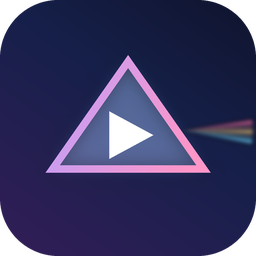
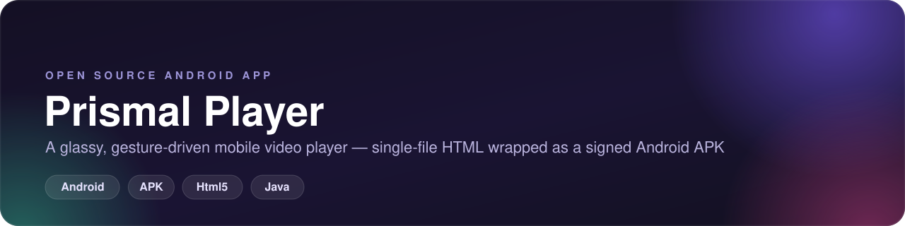

<div align="center">





<a href="https://github.com/technicalnihilist-lgtm/prismal-player/stargazers"></a>&nbsp;<a href="https://github.com/technicalnihilist-lgtm/prismal-player/network/members"></a>

<a href="https://github.com/technicalnihilist-lgtm/prismal-player/releases/latest/download/Prismal_Player.apk"></a> <a href="https://technicalnihilist-lgtm.github.io/apps-site/apps/prismal-player.html"></a>

<b>Support the work</b>

  

<sub>Donations aren't live yet — Paytm, UPI, PayPal and Buy&nbsp;Me&nbsp;a&nbsp;Coffee all show <b>coming soon</b>. Until then, a ⭐ star is the best support.</sub>

<a href="https://github.com/technicalnihilist-lgtm/prismal-player/releases/latest"></a>  <a href="https://github.com/technicalnihilist-lgtm/prismal-player/releases"></a>

</div>

---

## Install

1. Grab **`Prismal_Player.apk`** from the [latest release](../../releases/latest).
2. Copy it to the phone, tap it, and allow installs from that app once when Android asks.
3. Open **Prismal Player** → *Open videos* to load files from your phone, or *Paste a link* for a URL.

```bash
adb install -r Prismal_Player.apk
```

> The APK is signed with a self-signed key, so Play Protect may ask you to confirm the install. That is expected for sideloaded apps.

## What it does

- **Local or streaming playback** — pick videos from device storage or paste a direct video URL
- **Gesture controls** — drag vertically for volume (right half) or brightness (left half), drag sideways to scrub, double-tap to skip, tap to toggle controls
- **Glass UI** — frosted panels with adjustable blur, tint, radius, specular highlight and shadow
- **Picture tools** — fit modes, rotation, mirror, brightness / contrast / saturation, animated ambient glow sampled from the video
- **Audio** — volume, mute, and gain boost up to 300% for local files
- **Subtitles** — load `.srt` / `.vtt`, adjust size, delay and height
- **Playback** — speed, A–B loop, skip interval, sleep timer, resume where you left off, playlist queue
- **Feels native** — immersive edge-to-edge layout, notch-aware safe areas, hardware back, media notification controls, optional screen wake lock

## The Android wrapper

The app is a fullscreen, hardware-accelerated `WebView` — the HTML *is* the app. Everything native lives in one file, `MainActivity.java` (inside `Prismal_Player_source.zip`):

| Piece | Why |
|---|---|
| Virtual `https://prismal.local/` origin | Serving assets from `file://` makes modern Chromium refuse `localStorage`; a real origin keeps saved settings working |
| `onShowFileChooser` bridge | Connects the page's hidden `<input type="file">` to the Android document picker, multi-select included |
| Immersive + `LAYOUT_IN_DISPLAY_CUTOUT_MODE_SHORT_EDGES` | True fullscreen, and the page's `env(safe-area-inset-*)` CSS gets real values |
| `FLAG_KEEP_SCREEN_ON`, `configChanges` | Screen stays on while playing; rotating does not reload the player |
| External link handler | http(s) links open in your browser instead of trapping you inside the app |

| | |
|---|---|
| Package | `com.prismal.player` |
| Version | 1.0 (versionCode 1) |
| Min / target SDK | 24 (Android 7.0) / 34 (Android 14) |
| APK size | 134 KB |
| Signing | APK Signature Scheme v2 + v3 |

APK SHA-256: `938a4acd3e07553f5457f992cf88e1f5e882106be7205b539512f9edb7c11bd3`

## Build it yourself

Unzip `Prismal_Player_source.zip` from the latest release, open the `app/` folder in Android Studio (AGP 8.5, JDK 17) and press **Run** — or build with the Android SDK build-tools alone, no Gradle needed:

```bash
bash build.sh   # aapt2 → javac → d8 → zipalign → apksigner
```

The launcher icons are generated by `tools/make_icons.py` (needs Pillow); the prebuilt PNGs are already in the zip.

## Project layout

Inside `Prismal_Player_source.zip`:

```
app/
├── src/main/AndroidManifest.xml
├── src/main/java/com/prismal/player/MainActivity.java   # the whole native side
├── src/main/assets/index.html                            # the player (entire UI)
├── src/main/res/                                         # adaptive icon, theme, strings
├── build.gradle
└── build.sh                                              # SDK-only build, no Gradle
tools/
└── make_icons.py                                         # regenerates the launcher icons
```

Want to change how the app looks or behaves? Edit `index.html` — the CSS and JS live there in full. Nothing in the Java layer needs touching unless you change the icon, name or package id.

## Notes

- This repo holds the docs and the signed builds; the code travels with each release as `Prismal_Player_source.zip` so the binary APK and the source always stay in step.
- Rebuilds must be signed with the same key as an installed copy, or Android refuses the update. Keep your keystore safe; it is deliberately **not** in this repo.
- Screenshots are captured from the actual app UI at a 390 × 844 viewport.
- The demo clip used in the screenshots is generated locally and is not part of the APK.

---

Built with [Sarvam AI](https://sarvam.ai) — one HTML file in, one installable APK out.

---

## 🌍 Languages

<sub>Donations are <b>coming soon</b> in every language below — nothing to pay today, nothing to click.</sub>

<div align="center">

<sub><b>हिन्दी · বাংলা · मराठी · తెలుగు · தமிழ் · ગુજરાતી · ಕನ್ನಡ · മലയാളം · ਪੰਜਾਬੀ · ଓଡ଼ିଆ · অসমীয়া · اردو</b></sub>

</div>

<details>
<summary><b>🌍 Open the same message in 53 languages</b></summary>

**🇮🇳 Indian languages**

- **हिन्दी** (Hindi) — ☕ जल्द ही आ रहा है। · ⭐ अगर आपको यह ऐप और हमारा काम पसंद है, तो कृपया रिपॉजिटरी को स्टार दें और हमें फॉलो करें।
- **বাংলা** (Bengali) — ☕ খুব শিগগিরই আসছে। · ⭐ যদি আপনার এই অ্যাপ এবং আমাদের কাজ ভালো লাগে, তবে অনুগ্রহ করে রিপোজিটরিটিকে একটি স্টার দিন এবং আমাদের ফলো করুন।
- **मराठी** (Marathi) — ☕ लवकरच येत आहे. · ⭐ जर तुम्हाला हे ॲप आणि आमचं काम आवडलं असेल, तर कृपया रिपॉझिटरीला स्टार द्या आणि आम्हाला फॉलो करा.
- **తెలుగు** (Telugu) — ☕ త్వరలో రాబోతోంది. · ⭐ మీకు ఈ యాప్, మా పని నచ్చితే, దయచేసి రిపోజిటరీకి ఒక స్టార్ ఇచ్చి మమ్మల్ని ఫాలో అవ్వండి.
- **தமிழ்** (Tamil) — ☕ விரைவில் வருகிறது. · ⭐ உங்களுக்கு இந்த ஆப்பும் எங்க வேலையும் பிடிச்சிருந்தா, தயவுசெஞ்சு இந்த ரெபாசிட்டரிக்கு ஒரு ஸ்டார்…
- **ગુજરાતી** (Gujarati) — ☕ ટૂંક સમયમાં આવી રહ્યું છે. · ⭐ જો તમને આ એપ અને અમારું કામ ગમતું હોય, તો પ્લીઝ રિપોઝિટરીને સ્ટાર આપો અને અમને ફોલો કરો.
- **ಕನ್ನಡ** (Kannada) — ☕ ಶೀಘ್ರದಲ್ಲೇ ಬರುತ್ತಿದೆ. · ⭐ ನಿಮಗೆ ಈ ಆ್ಯಪ್ ಮತ್ತು ನಮ್ಮ ಕೆಲಸ ಇಷ್ಟವಾದರೆ, ದಯವಿಟ್ಟು ರೆಪೊಸಿಟರಿಗೆ ಸ್ಟಾರ್ ಕೊಡಿ ಮತ್ತು ನಮ್ಮನ್ನು ಫಾಲೋ ಮಾಡಿ.
- **മലയാളം** (Malayalam) — ☕ ഉടൻ വരുന്നു. · ⭐ നിങ്ങൾക്ക് ഈ ആപ്പും ഞങ്ങളുടെ പ്രവർത്തനവും ഇഷ്ടപ്പെട്ടെങ്കിൽ, ദയവായി റെപ്പോസിറ്ററിക്ക് ഒരു സ്റ്റാർ…
- **ਪੰਜਾਬੀ** (Punjabi) — ☕ ਜਲਦੀ ਆ ਰਿਹਾ ਹੈ। · ⭐ ਜੇ ਤੁਹਾਨੂੰ ਇਹ ਐਪ ਅਤੇ ਸਾਡਾ ਕੰਮ ਪਸੰਦ ਹੈ, ਤਾਂ ਕਿਰਪਾ ਕਰਕੇ ਰਿਪੋਜ਼ਟਰੀ ਨੂੰ ਸਟਾਰ ਦਿਓ ਅਤੇ ਸਾਨੂੰ ਫਾਲੋ ਕਰੋ।
- **ଓଡ଼ିଆ** (Odia) — ☕ ଖୁବ୍ ଶୀଘ୍ର ଆସୁଛି। · ⭐ ଯଦି ଆପଣଙ୍କୁ ଏହି ଆପ୍ ଏବଂ ଆମର କାମ ଭଲ ଲାଗୁଛି, ତେବେ ଦୟାକରି ରିପୋଜିଟୋରୀକୁ ଗୋଟିଏ ଷ୍ଟାର୍ ଦିଅନ୍ତୁ ଏବଂ ଆମକୁ ଫଲୋ କରନ୍ତୁ।
- **অসমীয়া** (Assamese) — ☕ অতি সোনকালেই আহি আছে। · ⭐ যদি আপুনি এই এপটো আৰু আমাৰ কাম ভাল পায়, তেন্তে অনুগ্ৰহ কৰি ৰিপজিটৰীটোক এটা ষ্টাৰ দিয়ক আৰু আমাক ফ'ল' কৰক।
- **اردو** (Urdu) — ☕ جلد آرہا ہے۔ · ⭐ اگر آپ کو یہ ایپ اور ہمارا کام پسند آئے تو براہ کرم ریپازٹری کو سٹار دیں اور ہمیں فالو کریں۔
- **संस्कृतम्** (Sanskrit) — ☕ शीघ्रमेव आगच्छति।
- **मैथिली** (Maithili) — ☕ जल्दिये आबि रहल अछि।
- **कोंकणी** (Konkani) — ☕ रोखडेंच येता.
- **کٲشُر** (Kashmiri) — ☕ جَلدی یِوان چھُ۔
- **سنڌي** (Sindhi) — ☕ जल्द अची रह्यो आहे।
- **डोगरी** (Dogri) — ☕ जल्दी आ करदा ऐ।
- **ꯃꯤꯇꯩ ꯂꯣꯟ** (Manipuri) — ☕ ꯑꯊꯨꯕꯥ ꯃꯇꯝꯗꯥ ꯂꯥꯛꯀꯅꯤ꯫
- **बर’** (Bodo) — ☕ थाबैनो फैगोन।
- **ᱥᱟᱱᱛᱟᱲᱤ** (Santali) — ☕ ᱞᱚᱜᱚᱱ ᱦᱤᱡᱩᱜ ᱠᱟᱱᱟ᱾
- **नेपाली** (Nepali) — ☕ छिट्टै आउँदैछ। · ⭐ यदि तपाईंलाई यो एप र हाम्रो काम मन पर्‍यो भने, कृपया रिपोजिटरीलाई स्टार दिनुहोस् र हामीलाई फलो गर्नुहोस्।

**🌍 World languages**

- **العربية** (Arabic) — ☕ قريبًا. · ⭐ إذا أعجبك هذا التطبيق وعملنا، فيرجى منح المستودع نجمة ومتابعتنا.
- **简体中文** (Chinese (Simplified)) — ☕ 即将推出。
- **繁體中文** (Chinese (Traditional)) — ☕ 即將推出。
- **Čeština** (Czech) — ☕ Již brzy.
- **Dansk** (Danish) — ☕ Kommer snart.
- **Nederlands** (Dutch) — ☕ Binnenkort beschikbaar. · ⭐ Vind je deze app en ons werk leuk?
- **Filipino** (Filipino) — ☕ Malapit na.
- **Suomi** (Finnish) — ☕ Tulossa pian.
- **Français** (French) — ☕ Bientôt disponible. · ⭐ Si cette application et notre travail vous plaisent, mettez une étoile au dépôt et suivez-nous.
- **Deutsch** (German) — ☕ Bald verfügbar. · ⭐ Wenn dir diese App und unsere Arbeit gefallen, gib dem Repository einen Stern und folge uns.
- **Ελληνικά** (Greek) — ☕ Έρχεται σύντομα.
- **עברית** (Hebrew) — ☕ בקרוב.
- **Magyar** (Hungarian) — ☕ Hamarosan.
- **Bahasa Indonesia** (Indonesian) — ☕ Segera hadir. · ⭐ Jika kamu suka aplikasi ini dan karya kami, beri bintang pada repositori ini dan ikuti kami.
- **Italiano** (Italian) — ☕ In arrivo.
- **日本語** (Japanese) — ☕ 近日公開。 · ⭐ このアプリと私たちの仕事が気に入ったら、リポジトリにスターを付けてフォローしてください。
- **한국어** (Korean) — ☕ 곧 공개됩니다. · ⭐ 이 앱과 저희 작업이 마음에 드신다면 저장소에 스타를 눌러 주시고 팔로우해 주세요.
- **Bahasa Melayu** (Malay) — ☕ Akan datang.
- **Norsk** (Norwegian) — ☕ Kommer snart.
- **فارسی** (Persian) — ☕ به‌زودی.
- **Polski** (Polish) — ☕ Wkrótce. · ⭐ Jeśli podoba Ci się ta aplikacja i nasza praca, daj repozytorium gwiazdkę i obserwuj nas.
- **Português** (Portuguese) — ☕ Em breve.
- **Română** (Romanian) — ☕ În curând.
- **Русский** (Russian) — ☕ Скоро. · ⭐ Если вам нравится это приложение и наша работа, поставьте звёздочку репозиторию и подпишитесь на нас.
- **Español** (Spanish) — ☕ Muy pronto. · ⭐ Si te gusta esta app y nuestro trabajo, dale una estrella al repositorio y síguenos.
- **Kiswahili** (Swahili) — ☕ Inakuja hivi karibuni.
- **Svenska** (Swedish) — ☕ Kommer snart.
- **ไทย** (Thai) — ☕ เร็ว ๆ นี้
- **Türkçe** (Turkish) — ☕ Çok yakında.
- **Українська** (Ukrainian) — ☕ Незабаром.
- **Tiếng Việt** (Vietnamese) — ☕ Sắp ra mắt. · ⭐ Nếu bạn thích ứng dụng này và công việc của chúng tôi, hãy tặng kho lưu trữ một ngôi sao và theo…

</details>

