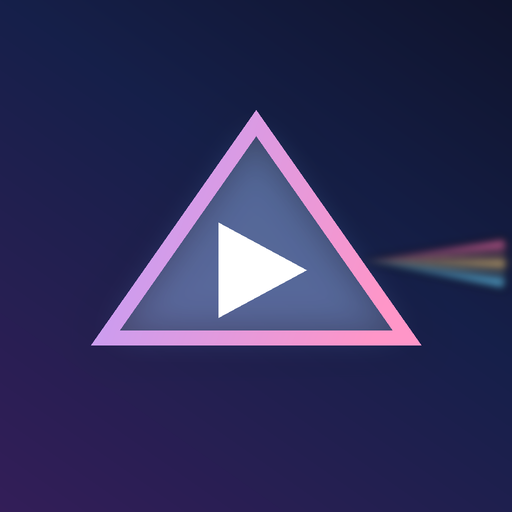
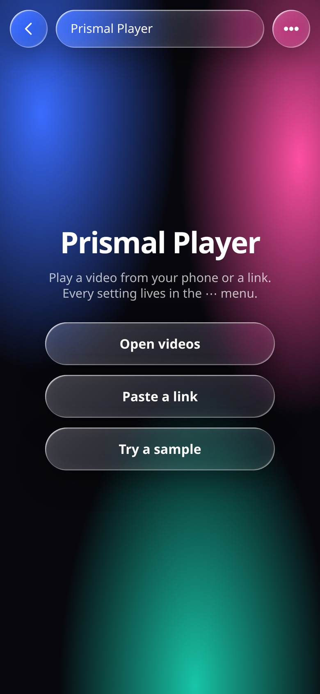
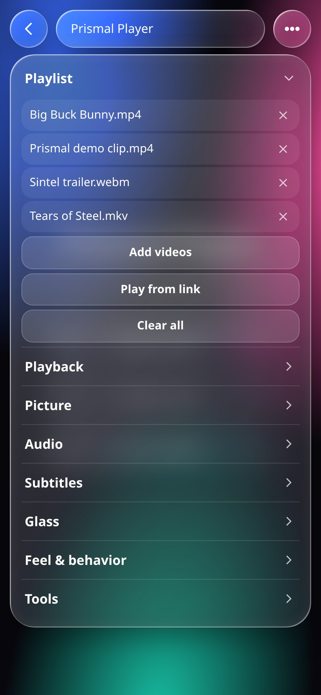
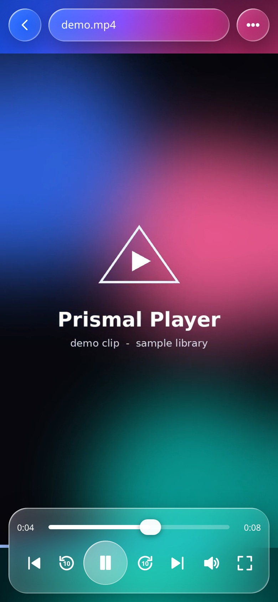
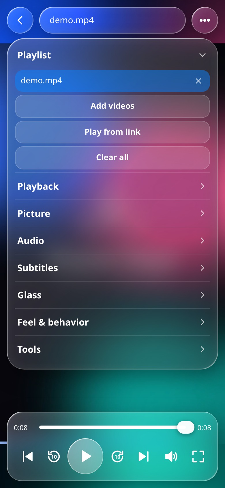

# Prismal Player



**A glassy, gesture-driven video player for your phone — one HTML file, wrapped as a real Android app.**


Prismal Player started life as a single self-contained `Prismal_Player.html` — no frameworks, no build step, no network calls. It now ships as a signed Android APK: that same file, wrapped in a thin native shell.

**⬇️ [Download the APK](../../releases/latest)**  ·  [Source project](../../releases/latest)

<table>
<tr>
<td align="center"><br><sub><b>Home</b></sub></td>
<td align="center"><br><sub><b>Playlist &amp; menu</b></sub></td>
</tr>
<tr>
<td align="center"><br><sub><b>Playing</b></sub></td>
<td align="center"><br><sub><b>Glass settings</b></sub></td>
</tr>
</table>

## Install

1. Grab **`Prismal_Player.apk`** from the [latest release](../../releases/latest).
2. Copy it to the phone, tap it, and allow installs from that app once when Android asks.
3. Open **Prismal Player** → *Open videos* to load files from your phone, or *Paste a link* for a URL.

```bash
adb install -r Prismal_Player.apk
```

> The APK is signed with a self-signed key, so Play Protect may ask you to confirm the install. That is expected for sideloaded apps.

## What it does

- **Local or streaming playback** — pick videos from device storage or paste a direct video URL
- **Gesture controls** — drag vertically for volume (right half) or brightness (left half), drag sideways to scrub, double-tap to skip, tap to toggle controls
- **Glass UI** — frosted panels with adjustable blur, tint, radius, specular highlight and shadow
- **Picture tools** — fit modes, rotation, mirror, brightness / contrast / saturation, animated ambient glow sampled from the video
- **Audio** — volume, mute, and gain boost up to 300% for local files
- **Subtitles** — load `.srt` / `.vtt`, adjust size, delay and height
- **Playback** — speed, A–B loop, skip interval, sleep timer, resume where you left off, playlist queue
- **Feels native** — immersive edge-to-edge layout, notch-aware safe areas, hardware back, media notification controls, optional screen wake lock

## The Android wrapper

The app is a fullscreen, hardware-accelerated `WebView` — the HTML *is* the app. Everything native lives in one file, `MainActivity.java` (inside `Prismal_Player_source.zip`):

| Piece | Why |
|---|---|
| Virtual `https://prismal.local/` origin | Serving assets from `file://` makes modern Chromium refuse `localStorage`; a real origin keeps saved settings working |
| `onShowFileChooser` bridge | Connects the page's hidden `<input type="file">` to the Android document picker, multi-select included |
| Immersive + `LAYOUT_IN_DISPLAY_CUTOUT_MODE_SHORT_EDGES` | True fullscreen, and the page's `env(safe-area-inset-*)` CSS gets real values |
| `FLAG_KEEP_SCREEN_ON`, `configChanges` | Screen stays on while playing; rotating does not reload the player |
| External link handler | http(s) links open in your browser instead of trapping you inside the app |

| | |
|---|---|
| Package | `com.prismal.player` |
| Version | 1.0 (versionCode 1) |
| Min / target SDK | 24 (Android 7.0) / 34 (Android 14) |
| APK size | 134 KB |
| Signing | APK Signature Scheme v2 + v3 |

APK SHA-256: `938a4acd3e07553f5457f992cf88e1f5e882106be7205b539512f9edb7c11bd3`

## Build it yourself

Unzip `Prismal_Player_source.zip` from the latest release, open the `app/` folder in Android Studio (AGP 8.5, JDK 17) and press **Run** — or build with the Android SDK build-tools alone, no Gradle needed:

```bash
bash build.sh   # aapt2 → javac → d8 → zipalign → apksigner
```

The launcher icons are generated by `tools/make_icons.py` (needs Pillow); the prebuilt PNGs are already in the zip.

## Project layout

Inside `Prismal_Player_source.zip`:

```
app/
├── src/main/AndroidManifest.xml
├── src/main/java/com/prismal/player/MainActivity.java   # the whole native side
├── src/main/assets/index.html                            # the player (entire UI)
├── src/main/res/                                         # adaptive icon, theme, strings
├── build.gradle
└── build.sh                                              # SDK-only build, no Gradle
tools/
└── make_icons.py                                         # regenerates the launcher icons
```

Want to change how the app looks or behaves? Edit `index.html` — the CSS and JS live there in full. Nothing in the Java layer needs touching unless you change the icon, name or package id.

## Notes

- This repo holds the docs and the signed builds; the code travels with each release as `Prismal_Player_source.zip` so the binary APK and the source always stay in step.
- Rebuilds must be signed with the same key as an installed copy, or Android refuses the update. Keep your keystore safe; it is deliberately **not** in this repo.
- Screenshots are captured from the actual app UI at a 390 × 844 viewport.
- The demo clip used in the screenshots is generated locally and is not part of the APK.

---

Built with [Sarvam AI](https://sarvam.ai) — one HTML file in, one installable APK out.
